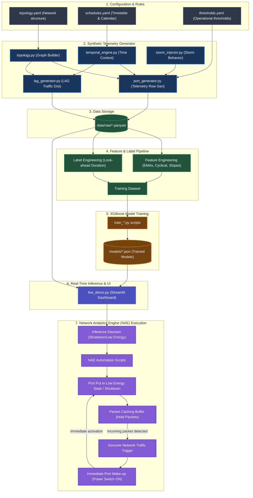

# AI-Driven Network Power Saver: Telemetry Feature Audit & System Architecture (HLD/LLD)

This document provides a comprehensive analysis of the features, targets, and parameters used in training the machine learning models for the campus network power-saving system. It also outlines the High-Level Design (HLD) and Low-Level Design (LLD) of the system architecture.

---

## 1. High-Level Design (HLD)

The campus network power-saver system is an end-to-end telemetry-driven machine learning pipeline. It is designed to capture telemetry across a simulated campus topology, engineer predictive features, train models, and execute real-time power-saving decisions (such as shutting down idle access ports, pruning LAG links, and alerting on broadcast storms).



### Component Breakdown
1. **Configuration & Rules**: Defines the physical layout of the university campus (zones, switch distribution, access port counts), standard timetables, exam/holiday weeks, and threshold safety guidelines.
2. **Synthetic Telemetry Generator**: Simulates realistic campus usage behaviors (day vs. night shifts, class schedules, exam weeks, sudden broadcast storms) and outputs time-series network counters at 5-minute intervals.
3. **Data Storage**: Persists raw network metrics as compressed Apache Parquet tables partitioned in batches (representing months of telemetry).
4. **Feature & Label Pipeline**: Prepares raw telemetry for ML. Engineers long-term memory indicators (Exponential Moving Averages), cyclical seasonality features, and calculates look-ahead target metrics (e.g., actual consecutive future idle hours).
5. **XGBoost Model Training**: Fits gradient-boosted decision trees (both classifiers and regressors) for specific tasks using past telemetry.
6. **Real-Time Inference & UI**: A Streamlit application that replays raw network streams, computes features on-the-fly, loads the trained models to make predictions, and visualizes recommended power-saving actions.
7. **Network Analytics Engine (NAE) Execution**: Handles automated script execution triggered by model predictions. Once a power-saving inference is made, the NAE executes Python/CLI scripts to shutdown ports or place them into a **Low Energy State**. When a port is in a low energy state, incoming packets are cached in a temporary software buffer. The moment genuine network traffic starts to flow, the buffer detects this activity and immediately wakes up the switch port (turning it back ON) to ensure seamless, zero-loss client connectivity.

---

## 2. Low-Level Design (LLD)

The core ML pipeline is divided into five specialized training sub-pipelines. The subsections below describe the mathematical transforms and algorithms implemented at the low level.

### 2.1 Feature Engineering Formulas

#### Cyclical Seasonality Encoding
To prevent the models from treating continuous variables (like hours 0-23 or weekdays 0-6) as scalar features where $23 > 0$, these variables are projected onto a 2D circle using sine and cosine transformations:

$$\text{sin\_hour} = \sin\left(\frac{2 \pi \cdot \text{hour}}{24}\right), \quad \text{cos\_hour} = \cos\left(\frac{2 \pi \cdot \text{hour}}{24}\right)$$

$$\text{sin\_dow} = \sin\left(\frac{2 \pi \cdot \text{day\_of\_week}}{7}\right), \quad \text{cos\_dow} = \cos\left(\frac{2 \pi \cdot \text{day\_of\_week}}{7}\right)$$

$$\text{sin\_day} = \sin\left(\frac{2 \pi \cdot \text{day\_of\_year}}{365}\right), \quad \text{cos\_day} = \cos\left(\frac{2 \pi \cdot \text{day\_of\_year}}{365}\right)$$

#### Exponential Moving Average (EMA)
To capture historical consumption habits without keeping raw time-series sequences in memory, we compute 7-day and 30-day EMAs over the 5-minute interval samples ($N$ represents the window size):

$$\text{EMA}_t = \alpha \cdot X_t + (1 - \alpha) \cdot \text{EMA}_{t-1}, \quad \text{where } \alpha = \frac{2}{N + 1}$$

- For **7-day EMA** ($N = 2,016$ intervals): $\alpha \approx 0.00099$
- For **30-day EMA** ($N = 8,640$ intervals): $\alpha \approx 0.00023$
- **7-day EMA Slope**: Captures speed of network activity decay: $\text{slope}_t = \text{EMA}_t - \text{EMA}_{t - 288}$ (change over the last 24 hours).

### 2.2 Label Engineering Algorithm (Future Idle Duration)

The duration label computes how long a port or LAG will remain idle in the future. To prevent data leakage, this is calculated strictly on the training set by reversing the sorted time-series data:

```python
def get_remaining_idle_duration(group):
    # 'is_idle' is a boolean flag (utilization < 1.0)
    s = group['is_idle'].astype(int).iloc[::-1]  # Reverse the sequence
    
    # Calculate consecutive cumulative counts of active idles
    consecutive_groups = (s != s.shift()).cumsum()
    counts = s * (s.groupby(consecutive_groups).cumcount() + 1)
    
    # Reverse back to standard chronological order and convert to hours
    return (counts.iloc[::-1] * 5) / 60.0
```

### 2.3 Model Definitions & Training Details

| Target File | Algorithm | Target Label | Loss/Objective Function | Key Training Parameters |
| :--- | :--- | :--- | :--- | :--- |
| **`port_idle_classifier.json`** | XGBClassifier | `is_idle_next_1_hour` (Binary) | `binary:logistic` | `n_estimators=100`, `learning_rate=0.1`, `max_depth=6` |
| **`port_idle_duration_regressor.json`** | XGBRegressor | `idle_duration_future_mins / 60.0` (Hours) | `reg:squarederror` | `n_estimators=100`, `learning_rate=0.1`, `max_depth=6` |
| **`long_term_duration_regressor.json`** | XGBRegressor | `log1p(idle_duration_hours)` (Compressed) | `reg:squarederror` | `n_estimators=200`, `learning_rate=0.05`, `max_depth=7` |
| **`poe_device_fingerprint.json`** | XGBClassifier | `endpoint_type` (3 classes: AP, Phone, Camera) | `multi:softprob` | `n_estimators=50`, `learning_rate=0.3`, `max_depth=6` |
| **`poe_shutdown_classifier.json`** | XGBClassifier | `can_shutdown` (Binary) | `binary:logistic` | `n_estimators=50`, `learning_rate=0.3`, `max_depth=6` |
| **`poe_duration_regressor.json`** | XGBRegressor | `idle_duration_hours` (Hours) | `reg:squarederror` | `n_estimators=50`, `learning_rate=0.3`, `max_depth=6` |
| **`lag_shutdown_classifier.json`** | XGBClassifier | `valid_shutdown` (Binary) | `binary:logistic` | `n_estimators=100`, `learning_rate=0.3`, `max_depth=6` |
| **`lag_reason_classifier.json`** | XGBClassifier | `reason_code` (3 classes: Nightly, Weekend, Other) | `multi:softprob` | `n_estimators=50`, `learning_rate=0.3`, `max_depth=6` |
| **`lag_duration_regressor.json`** | XGBRegressor | `shutdown_duration_hours` (Hours) | `reg:squarederror` | `n_estimators=100`, `learning_rate=0.3`, `max_depth=6` |
| **`storm_warning_classifier.json`** | XGBClassifier | `storm_in_next_30m` (Binary) | `binary:logistic` | `n_estimators=100`, `learning_rate=0.3`, `max_depth=6` |

---

## 3. Feature Audit Matrix

The following matrix charts the mapping between the raw/engineered features and each trained model file:

| Feature Name | Port Idle Clf | Port Idle Reg | Long-Term Reg | PoE Fingerprint | PoE Shut Clf | PoE Dur Reg | LAG Shut Clf | LAG Reason | LAG Dur Reg | Storm Clf |
| :--- | :---: | :---: | :---: | :---: | :---: | :---: | :---: | :---: | :---: | :---: |
| **`total_utilization`** | ✔ | ✔ | | | | | | | | |
| **`rx_utilization`** | | | | ✔ | ✔ | ✔ | | | | ✔ |
| **`tx_utilization`** | | | | ✔ | ✔ | ✔ | | | | ✔ |
| **`packet_rate_pps`** | | | | ✔ | | | | | | |
| **`active_ip_count`** | | | | ✔ | | | | | | |
| **`hour`** | ✔ | ✔ | ✔ | | ✔ | ✔ | ✔ | ✔ | ✔ | |
| **`minute`** | ✔ | ✔ | | | | | | | | |
| **`day_of_week`** | ✔ | ✔ | ✔ | | ✔ | ✔ | | | | |
| **`is_weekend`** | ✔ | ✔ | ✔ | | | | ✔ | ✔ | ✔ | |
| **`consecutive_idle_windows`** | ✔ | ✔ | ✔ | | | | | | | |
| **`is_burst`** | ✔ | ✔ | | | | | | | | |
| **`ema_7d`** | | | ✔ | | | | | | | |
| **`ema_30d`** | | | ✔ | | | | | | | |
| **`ema_7d_slope`** | | | ✔ | | | | | | | |
| **`sin_day`** | | | ✔ | | | | | | | |
| **`cos_day`** | | | ✔ | | | | | | | |
| **`sin_hour`** | | | ✔ | | | | | | | |
| **`cos_hour`** | | | ✔ | | | | | | | |
| **`sin_dow`** | | | ✔ | | | | | | | |
| **`cos_dow`** | | | ✔ | | | | | | | |
| **`idle_duration_minutes`** | | | ✔ | | | | | | | |
| **`time_since_last_burst_minutes`** | | | ✔ | | | | | | | |
| **`aggregate_utilization`** | | | | | | | ✔ | ✔ | ✔ | |
| **`member_imbalance_ratio`** | | | | | | | ✔ | ✔ | ✔ | |
| **`total_members`** | | | | | | | ✔ | ✔ | ✔ | |
| **`queue_depth`** | | | | | | | | | | ✔ |
| **`queue_drops`** | | | | | | | | | | ✔ |
| **`flow_count`** | | | | | | | | | | ✔ |

---

## 4. Parameter Descriptions

### Used Parameters

*   **`total_utilization`**: Combined bidirectional traffic as a percentage of full link speed. Crucial indicator of port activity.
*   **`rx_utilization` / `tx_utilization`**: Inbound/Outbound link utilization. Important for detecting asymmetric workflows (e.g., cameras transmit only) and storm loops.
*   **`packet_rate_pps`**: Number of packets processed per second. Essential for PoE device fingerprinting (IP cameras send steady, small packet streams, APs are highly bursty).
*   **`active_ip_count`**: Active IP addresses bound to the port. Higher counts correlate with switches or wireless Access Points (APs).
*   **`hour` / `minute`**: Raw time values. Pinpoint immediate schedules (class blocks, lunchtime, late-night dormancy).
*   **`day_of_week` / `is_weekend`**: Weekday/Weekend identifiers. Separates academic work schedules from residential peak hours.
*   **`consecutive_idle_windows`**: Running index of consecutive silent intervals. Helps duration regressors evaluate long-standing idle history.
*   **`is_burst`**: Boolean flag showing if traffic spiked during the interval. A sudden burst implies active user interaction, delaying shutdowns.
*   **`ema_7d` / `ema_30d`**: Long-term exponential moving averages. Serves as a baseline profile of regular utilization trends.
*   **`ema_7d_slope`**: Trend direction indicating if overall port load is increasing or decreasing over a rolling 24-hour window.
*   **`sin_day` / `cos_day`**: Continuous coordinate maps of calendar days. Guides seasonality predictions (such as winter breaks).
*   **`sin_hour` / `cos_hour` / `sin_dow` / `cos_dow`**: Smooth mathematical representation of daily/weekly temporal loops.
*   **`idle_duration_minutes`**: Running counter of current inactivity.
*   **`time_since_last_burst_minutes`**: Inactivity period since the last sudden high-throughput transmission.
*   **`aggregate_utilization`**: Hashed sum of all LAG member traffic divided by total physical capacity.
*   **`member_imbalance_ratio`**: Hashing performance metric checking if link traffic distribution is skewed.
*   **`total_members`**: Number of child links bundled within the LAG.
*   **`queue_depth`**: Queue buffer usage count. Storm events saturate buffers, pushing depth to its maximum.
*   **`queue_drops`**: Ingress packets discarded due to full buffers. Heavy drops denote network storms.
*   **`flow_count`**: Unique traffic conversational streams. Severe loop storms cause exponential surges in flows.

---

## 5. Unused Parameters Audit

The following parameters are generated by the simulation engine but are **omitted** from ML training:

| Parameter Name | Data Type | Reason for Exclusion | Future Improvement Potential |
| :--- | :--- | :--- | :--- |
| **`port_id`** | String | High-cardinality identity. Inclusion leads to overfitting/memorization of specific ports. | Can be mapped to generic ordinal labels or frequency-encoded if port history is needed. |
| **`switch_id`** | String | High-cardinality identity. Excluded to ensure models generalize across any switch. | Could be grouped by switch scale (e.g., Core vs. Distribution) as a categorical feature. |
| **`zone`** | String | Categorical layout location (e.g., `academic`). Excluded to prevent hardcoding static zone rules. | Can be target-encoded or one-hot encoded to help models learn zone-specific characteristics. |
| **`building` / `floor`** | String / Int | Static physical locations. Do not generalize to new topologies. | Could be converted into structural markers (e.g., building size, switch density per floor). |
| **`vlan`** | Integer | Network segment ID. Doesn't correlate with physical layer power consumption. | Could help detect broadcast storm isolation bounds. |
| **`duplex` / `mtu`** | String / Int | Constants (`full` / `1500`). Zero-variance features provide no mathematical value to XGBoost. | None. Safe to permanently ignore. |
| **`admin_status`** | String | Constant (`up`). Features must be administratively active for the agent to consider shutting them down. | None. |
| **`operational_status`** | String | Current status (`up` / `down`). Target variable proxy. Using it directly as a feature causes target leakage. | None. |
| **`rx_bytes` / `tx_bytes`** | Float | Raw byte counts. Excluded because they scale with port speeds. | Preferred to use normalized `rx_utilization` and `tx_utilization` instead. |
| **`input_rate_bps` / `output_rate_bps`** | Float | Raw speed rates. Excluded in favor of utilization percentages. | Redundant; utilization percentage is scale-independent. |
| **`link_speed_mbps`** | Float | Capacity speed limit. Excluded since relative utilization percentages are preferred. | Could help scale regressor output weights if traffic capacity matters. |
| **`active_mac_count`** | Integer | MAC address count. Redundant; highly correlated with `active_ip_count`. | Could be used as a cross-verification check, but active IP counts are usually more accurate. |
| **`poe_consumption_watts`** | Float | Power draw of PoE device. Omitted because the models predict when to shut down PoE based on traffic, not active draw. | Could act as an excellent input feature: higher power draws might require more conservative shutdown checks. |
| **`occupancy`** | Float | Ground-truth simulation parameter. Leakage parameter; not observable in physical enterprise switches. | Useful for validation and simulation verification, but must remain excluded from training. |
| **`is_holiday`** | Boolean | Holiday flag. Extremely sparse in the short 2-month dataset, leading to potential overfitting. | With a multi-year training dataset, holidays can be incorporated. |
| **`semester_state`** | String | Course schedule season (e.g., orientation, regular). Excluded because EMAs capture seasonal shifts more dynamically. | Could be one-hot encoded if models need high-level calendar context. |
| **`is_class_hours`** | Boolean | Derived time indicator. Excluded since raw temporal features are more expressive. | Redundant; tree models split on hour/weekend values automatically. |
| **`minimum_required_members`** | Integer | Minimum links needed for LAG. Used exclusively as target label generator. | None. Including it would result in direct target leakage. |
| **`active_member_count` / `standby_member_count`**| Integer | Active/standby count. Simulation tracker variables. | Could assist in calculating current headroom, but not needed for basic optimization. |
| **`current_bandwidth_mbps` / `max_bandwidth_mbps`** | Float | LAG speed limits. Redundant with aggregate utilization ratio. | Redundant. |
